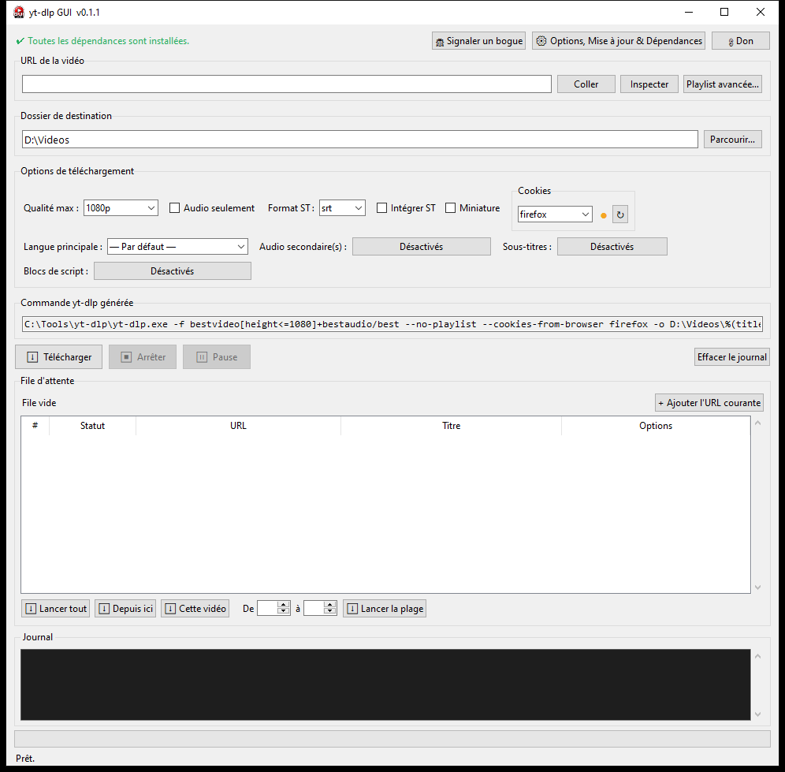
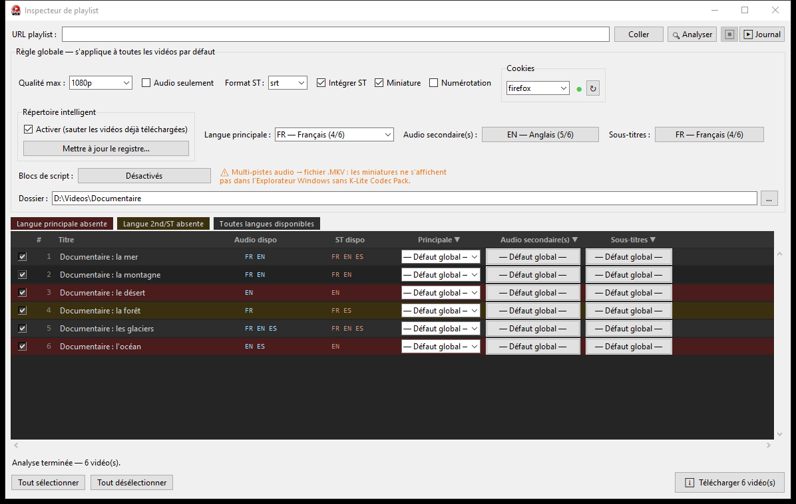
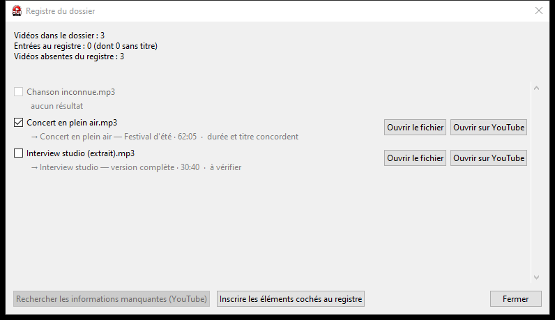

# yt-dlp GUI

[Français](README.md) · [English](docs/README.en.md) · [Español](docs/README.es.md) · [Português](docs/README.pt.md) · [Italiano](docs/README.it.md) · [Polski](docs/README.pl.md) · [Magyar](docs/README.hu.md) · [Srpski](docs/README.sr.md) · [Русский](docs/README.ru.md) · [Tiếng Việt](docs/README.vi.md) · [中文](docs/README.zh.md) · [हिन्दी](docs/README.hi.md) · [日本語](docs/README.ja.md) · [한국어](docs/README.ko.md) · [Filipino](docs/README.fil.md)

Interface graphique pour [yt-dlp](https://github.com/yt-dlp/yt-dlp), pensée pour rendre son utilisation accessible à tous tout en exploitant pleinement ses capacités.

> **Projet en cours de développement.** Certaines fonctionnalités peuvent changer, être incomplètes ou contenir des bogues. Le logiciel est disponible sous Windows ; **une préversion pour Linux** est aussi proposée, moins éprouvée.

🐧 **Linux** : [README-LINUX](README-LINUX.md)





## Fonctionnalités

### Téléchargeur individuel et file d'attente

- **Options** : qualité maximale (jusqu'à la 4K), audio seul (MP3), sous-titres (formats vtt, srt, ass), intégration des sous-titres et de la miniature, langue audio principale, pistes audio secondaires (fichier MKV multi-pistes) et bibliothèque de « blocs de script » (post-traitement, export, réseau, comportement) que vous pouvez compléter avec vos propres blocs.
- **Pistes audio multiples** : dans le fichier MKV, chaque piste audio porte l'étiquette de sa langue (« fra », « eng »…) ; votre lecteur l'affiche dans son menu audio.
- **Commande générée** : la commande yt-dlp correspondant à vos choix s'affiche en direct.
- **File d'attente** : ajoutez l'URL courante, puis lancez toute la file, à partir d'un élément, une seule vidéo ou une plage ; pause et reprise, saut de l'élément en cours, arrêt avec nettoyage des fichiers partiels. La file est conservée d'une session à l'autre.
- **Noms de fichiers existants** : une vidéo seule dont le nom existe déjà dans le dossier de destination reçoit un suffixe (`_2`, `_3`…) pour ne rien écraser. Une playlist téléchargée depuis ce téléchargeur n'est pas renumérotée : les vidéos déjà présentes dans le dossier sont ignorées (« has already been downloaded »).

### Inspecteur de playlist

- **Analyse** d'une playlist : chaque vidéo est listée avec ses pistes audio et ses sous-titres disponibles ; les éléments masqués, privés ou supprimés sont ignorés sans bloquer le reste.
- **Règles globales** (qualité, audio seul, format et intégration des sous-titres, miniature, numérotation, langues, blocs de script, dossier de sortie) avec des **exceptions par vidéo** pour la langue principale, les pistes secondaires et les sous-titres.
- **Code couleur** : rouge quand la langue principale est absente, orange quand une piste secondaire ou un sous-titre manque.
- **Téléchargement de la sélection** avec journal, pause, reprise et saut ; si des pistes demandées n'existent pas, la vidéo est relancée sans elles, puis un **bilan** indique ce qui a réussi, a été ajusté ou a échoué.

### Répertoire intelligent et registre

- **Répertoire intelligent** : yt-dlp saute les vidéos déjà téléchargées grâce à un registre stocké dans le dossier de sortie. Le fichier `.yt-dlp-registre.json` contient l'identifiant, l'URL, le titre, la durée, le nom du fichier et la date de chaque vidéo ; `.yt-dlp-archive.txt`, lu par yt-dlp, en est dérivé.
- **Rétroaction** : si des vidéos de la sélection sont déjà présentes dans le dossier sans figurer au registre, une fenêtre vous propose de les inscrire et de les sauter (comparaison des titres). Vous pouvez décocher les faux positifs.
- **Mettre à jour le registre** : compte les vidéos du dossier, celles du registre et celles qui manquent, puis cherche les informations manquantes sur YouTube (titre, et durée via ffprobe). Rien n'est inscrit sans votre confirmation, et deux boutons ouvrent le fichier local ou le lien YouTube trouvé pour vérifier.



### Cookies du navigateur

- Choisissez le navigateur (Chrome, Firefox, Edge, Brave, Opera) dont yt-dlp lit les cookies, en local : ils sont nécessaires pour les pistes audio secondaires et certains sous-titres. **Firefox est recommandé.**
- **Résultats de nos essais** (Windows 11, octobre 2026, compte YouTube connecté dans chaque navigateur) : **Firefox** fonctionne, navigateur ouvert ou fermé. **Opera** ne fonctionne que **navigateur fermé** : il verrouille sa base de cookies tant qu'il est ouvert, et yt-dlp affiche alors « Could not copy Chrome cookie database ». **Chrome, Edge et Brave** échouent même fermés : ils chiffrent leurs cookies d'une façon que yt-dlp ne sait pas toujours lire. Ces limites viennent des navigateurs et de yt-dlp, pas du logiciel, et peuvent évoluer avec leurs mises à jour.
- Si votre navigateur est réglé pour **supprimer les cookies à la fermeture** (ou si vous naviguez en mode privé), il ne reste aucun cookie à lire sur le disque : yt-dlp ne peut rien récupérer, que ce soit avec Chrome, Edge, Brave ou Firefox. Avec Chrome, Edge et Brave, c'est un piège : il faut fermer le navigateur, ce qui efface alors les cookies. Désactivez cette option, ou conservez les cookies de youtube.com et google.com.
- Un **voyant** indique l'état : rouge si désactivé ou en échec, orange si non testé ou en cours, vert si les cookies sont chargés. Le bouton ↻ lance un test et l'infobulle explique l'état ou l'erreur.
- **Sous Linux (préversion)** : par défaut, Firefox, Google Chrome, Chromium, Brave et Vivaldi sont proposés, les plus utilisés sur ce système ; la fenêtre « Navigateurs pour les cookies » du menu des options permet de cocher jusqu'à 11 navigateurs (aussi Opera, Microsoft Edge, LibreWolf, Waterfox, Floorp et Zen Browser). Les navigateurs de la famille Chromium protègent leurs cookies avec le trousseau de clés du bureau (GNOME Keyring, KWallet) : il doit être déverrouillé, donc une session graphique ouverte. Seule la lecture des cookies de Firefox a été essayée avec un compte YouTube connecté (vidéos privées comprises) ; **Firefox est recommandé**.

### Assistant d'installation, dépendances et mises à jour de yt-dlp

- **Assistant d'installation** : au premier lancement, il propose de télécharger yt-dlp et ffmpeg depuis leurs dépôts officiels GitHub. La somme de contrôle SHA-256 est vérifiée et aucun droit administrateur n'est requis.
- **Dépendances** : la fenêtre dédiée vérifie ffmpeg, ffprobe, AtomicParsley, MKVToolNix, aria2 et deno, et peut les installer avec Chocolatey. Seuls ffmpeg et ffprobe sont indispensables ; deno est recommandé (pistes audio secondaires) ; AtomicParsley, MKVToolNix et aria2 sont facultatifs : le logiciel fonctionne sans eux. Sous Linux, l'assistant télécharge ffmpeg, ffprobe et deno (somme SHA-256 vérifiée, sans droits administrateur) ; pour AtomicParsley, MKVToolNix et aria2, la fenêtre affiche la commande de votre gestionnaire de paquets (apt, dnf, pacman ou zypper) à copier dans un terminal.
- **Mise à jour et diagnostic** : met à jour yt-dlp (`yt-dlp -U`) ou remplace son exécutable, affiche sa version et vérifie les options utilisées par le GUI.
- **Mise à jour du logiciel** : une vérification quotidienne (désactivable) signale une nouvelle version par un discret bandeau ; la fenêtre dédiée affiche les nouveautés et ouvre le téléchargement correspondant à votre installation (installateur ou version portable). Rien n'est installé automatiquement. Un interrupteur du menu des options (« Vérifier les mises à jour au démarrage ») active ou désactive la vérification automatique, et « Rechercher une mise à jour du logiciel… » la lance à la demande. Sous Linux, c'est l'AppImage ou l'archive `.tar.gz` correspondant à votre architecture.

### Interface et langues

- Les contrôles se replient selon la largeur de la fenêtre ; le contenu défile verticalement, et le tableau de l'inspecteur aussi horizontalement.
- Interface en **15 langues** : français, anglais, espagnol, portugais, italien, polonais, hongrois, serbe, russe, vietnamien, chinois, hindi, japonais, coréen et filipino. Le changement de langue s'applique au redémarrage, avec la possibilité de redémarrer tout de suite.

### Signaler un bogue

- Le bouton « Signaler un bogue » prépare un rapport technique : versions du logiciel, de Python, du système et de yt-dlp, réglages sans danger et dernières lignes du journal. Vos dossiers, votre nom d'utilisateur et vos adresses e-mail sont masqués. Envoyer le rapport sur GitHub demande un compte GitHub gratuit.
- Rien n'est envoyé automatiquement : vous relisez et modifiez le rapport, puis vous ouvrez une page de ticket GitHub déjà remplie (ou vous copiez le rapport).

## Installation

- **Installateur (recommandé)** : téléchargez `yt-dlp-gui-setup-X.Y.Z.exe` depuis la page des [versions publiées](https://github.com/harlockSuites/YT-dlp-GUI/releases) et lancez-le. Windows 10 ou 11 (64 bits), sans droits administrateur ; Python n'est pas nécessaire.
- **Version portable** : téléchargez `yt-dlp-gui-portable-X.Y.Z.zip`, décompressez-le où vous voulez et lancez `yt-dlp-gui.exe` ; les réglages restent dans ce dossier.
- **Linux, AppImage (préversion)** : téléchargez `yt-dlp-gui-X.Y.Z-x86_64.AppImage` depuis la page des [versions publiées](https://github.com/harlockSuites/YT-dlp-GUI/releases), rendez-le exécutable (`chmod +x`) et lancez-le. Il demande `libfuse2` (paquet `libfuse2` ou `fuse-libs`) ; sans lui, lancez-le avec `--appimage-extract-and-run`.
- **Linux, archive (préversion)** : téléchargez `yt-dlp-gui-linux-X.Y.Z-x86_64.tar.gz`, extrayez-la (`tar xzf`) puis lancez `./yt-dlp-gui/yt-dlp-gui`. Les réglages et les outils téléchargés sont dans `~/.local/share/yt-dlp-GUI` ; pour désinstaller, supprimez ce dossier et le fichier ou le dossier du logiciel.
- **Linux, ajout au menu des applications (préversion)** : depuis l'AppImage ou l'archive, le menu des options › « Installer dans le menu » copie le programme dans `~/.local/share/yt-dlp-GUI/app`, ajoute le lanceur et l'icône au menu de votre bureau et, au choix, un raccourci sur le Bureau, sans droits administrateur. La même fenêtre permet de mettre à jour ou de désinstaller ; vos réglages sont conservés.
- **Linux, paquet .deb (préversion)** : sous Debian, Ubuntu et dérivés, téléchargez `yt-dlp-gui_X.Y.Z_amd64.deb` puis installez-le avec `sudo apt install ./yt-dlp-gui_X.Y.Z_amd64.deb`. Le logiciel apparaît dans le menu des applications avec son icône ; `sudo apt remove yt-dlp-gui` le retire, et vos réglages (`~/.local/share/yt-dlp-GUI`) sont conservés.
- **Linux, configuration requise et vérification** : Linux 64 bits (x86_64) d'une distribution de 2022 ou plus récente (glibc 2.35 ou plus). Pour vérifier un fichier, téléchargez aussi `SHA256SUMS-linux.txt` et lancez, dans le même dossier : `sha256sum -c SHA256SUMS-linux.txt --ignore-missing`. Les fichiers Linux sont publiés à part, dans les versions dont l'étiquette commence par « Linux-v » (marquées « Pre-release » sur GitHub) ; la version affichée par défaut sur la page est celle de Windows.
- **Depuis les sources** : voir les sections « Prérequis » et « Démarrage rapide » ci-dessous.
- **Désinstallation** : Paramètres Windows › Applications › Applications installées › yt-dlp GUI, ou le raccourci « Désinstaller » du menu Démarrer. Le logiciel propose de supprimer aussi ses données (réglages, file d'attente, yt-dlp et ffmpeg téléchargés) ; vos vidéos ne sont jamais supprimées. L'installation étant propre à chaque compte Windows, le logiciel n'apparaît que dans la liste du compte qui l'a installé. Pour la version portable, supprimez simplement son dossier. Les outils installés à part avec Chocolatey (ffmpeg, Deno…) ne sont pas retirés.
- **Analyse antivirus (VirusTotal)** : la version 0.1.7 a été analysée le 21 octobre 2026. L'[installateur](https://www.virustotal.com/gui/file/7177f2dc75c3b5309b2d6b96a2104d578dbaf67a0c8ed28af286aa37159df91c) est signalé par 4 moteurs sur 69 (Arctic Wolf, Microsoft, SecureAge, Skyhigh) avec des détections heuristiques génériques ; le [lanceur de la version portable](https://www.virustotal.com/gui/file/6889bde864b341a948dc23c01e29eba3c63315145705eb0d5bb24a4964b0735a) l'est par 5 sur 70 (Arctic Wolf, CrowdStrike Falcon, Microsoft, SecureAge, Zillya) et l'[archive ZIP portable](https://www.virustotal.com/gui/file/7fd0a4bb101ca4b4c513ff42e0782cc2371304c643bf03cb3ccd8e9abdb43706) par 1 sur 66 (Zillya, sur l'archive elle-même). Ce sont probablement des faux positifs dus à un programme compressé et non signé. Ces résultats ne valent que pour cette version. En cas de doute, vérifiez la somme SHA-256.
- **Code signing policy** : les fichiers ne sont pas signés numériquement. Une demande de signature gratuite à la SignPath Foundation a été refusée le 19 octobre 2026 (projet encore trop peu visible publiquement) et pourra être renouvelée ; la [politique de signature](https://github.com/harlockSuites/YT-dlp-GUI/blob/main/docs/CODE_SIGNING_POLICY.md) décrit le processus prévu si un certificat est obtenu.
- **Avertissement Windows SmartScreen** : l'installateur n'est pas signé numériquement, donc Windows peut afficher « Windows a protégé votre ordinateur ». Cliquez sur « Informations complémentaires », puis sur « Exécuter quand même ». Pour vérifier l'authenticité du fichier, comparez sa somme SHA-256 avec celle de `SHA256SUMS.txt`, publié avec chaque version :

```powershell
Get-FileHash .\yt-dlp-gui-setup-X.Y.Z.exe -Algorithm SHA256
```

## Avertissements de Windows et des navigateurs

Ce logiciel est gratuit, publié par une seule personne, et ses fichiers ne sont **pas encore signés numériquement**. Un fichier neuf, que presque personne n'a encore téléchargé, n'a pas de « réputation » : les navigateurs et Windows affichent donc des avertissements **même pour un logiciel sûr**. Un avertissement ne prouve pas qu'un fichier est dangereux, et son absence ne prouve pas qu'il est sûr : voici comment vérifier vous-même.

- **Navigateur** (Firefox, Chrome, Edge, Brave) : le téléchargement peut être signalé comme « peu courant » ou comme « contenant un virus ou un logiciel malveillant ». C'est une analyse automatique de la réputation du fichier. Vérifiez d'abord la somme de contrôle (ci-dessous) ; si elle correspond, vous pouvez choisir l'option qui autorise ou conserve le téléchargement.
- **Windows SmartScreen** : « Windows a protégé votre ordinateur » → cliquez sur « Informations complémentaires » puis « Exécuter quand même », **après** avoir vérifié la somme de contrôle.
- **Microsoft Defender (Sécurité Windows)** : il peut mettre en quarantaine ou supprimer le fichier en indiquant « Trojan:Win32/Wacatac.C!ml ». Le suffixe `!ml` désigne une détection automatique par apprentissage automatique, fréquente sur un fichier neuf et non signé ; ces détections ont été signalées à Microsoft comme des faux positifs. Après avoir vérifié la somme SHA-256 (ci-dessous), vous pouvez restaurer le fichier : Sécurité Windows › Protection contre les virus et menaces › Historique de protection › ouvrez l'élément › Actions › « Autoriser sur l'appareil » (ou « Restaurer »). Ne désactivez pas la protection de Windows et n'ajoutez pas d'exclusion plus large que ce seul fichier.
- **Antivirus** : quelques moteurs affichent des détections génériques (voir l'analyse antivirus ci-dessus). Pour voir l'analyse de votre fichier, collez sa somme SHA-256 dans la barre de recherche de [VirusTotal](https://www.virustotal.com/) : si le fichier est déjà connu, vous obtenez le rapport sans l'envoyer.
- **Vérifier votre téléchargement** : téléchargez aussi `SHA256SUMS.txt` depuis la même page de version, ouvrez PowerShell dans le dossier des fichiers et lancez la commande ci-dessous : elle compare chaque fichier à la somme publiée et affiche `OK` ou `DIFFERENT`. Si un fichier est `DIFFERENT`, ne l'exécutez pas.

```powershell
Get-Content .\SHA256SUMS.txt | ForEach-Object { $h, $n = $_ -split '\s+\*?', 2; if ((Get-FileHash $n -Algorithm SHA256).Hash -eq $h.ToUpper()) { "$n : OK" } else { "$n : DIFFERENT" } }
```

- Cette vérification prouve que votre fichier est **identique** à celui publié sur GitHub ; elle ne prouve pas à elle seule qu'il est sans danger. Le code source et la construction automatique des fichiers ([GitHub Actions](https://github.com/harlockSuites/YT-dlp-GUI/actions)) sont publics, et il n'existe pas encore de signature numérique : une demande à la SignPath Foundation a été refusée le 19 octobre 2026 (voir la « Code signing policy »).

## Prérequis

- Windows 10 ou 11, ou Linux 64 bits (préversion)
- [Python 3](https://www.python.org/) avec Tkinter (inclus dans l'installation standard) (sous Linux : paquet `python3-tk`)
- `yt-dlp.exe` et, de préférence, [ffmpeg](https://ffmpeg.org/) : l'assistant d'installation les télécharge au premier lancement (sous Linux : `yt-dlp`, sans `.exe`)

## Démarrage rapide

1. Téléchargez ou clonez ce dépôt et placez-vous dans son dossier.
2. Lancez `yt-dlp-gui.bat` (ou `pythonw yt-dlp-gui.pyw`). Sous Linux : `python3 yt-dlp-gui.pyw`.
3. Au premier lancement, laissez l'assistant installer yt-dlp et ffmpeg ; il reste accessible dans le menu des options.
4. Collez une URL, choisissez vos options, puis téléchargez, ajoutez à la file ou ouvrez l'inspecteur pour une playlist.

## Confidentialité et usage responsable

- Ce logiciel n'envoie aucune donnée à l'auteur et ne contient aucune télémétrie. Les connexions réseau passent par yt-dlp (sites vidéo), l'assistant d'installation (GitHub) et l'outil de registre (recherche YouTube). Une vérification automatique des mises à jour contacte aussi GitHub au démarrage (au plus une fois par jour) ; vous pouvez la désactiver depuis « Vérifier les mises à jour au démarrage ».
- Vos cookies restent sur votre ordinateur : yt-dlp les lit localement dans le navigateur choisi.
- Utilisez cet outil dans le respect du droit d'auteur, des conditions d'utilisation des sites et des lois de votre pays, et ne téléchargez que ce que vous avez le droit de télécharger.

## Développement

Les tests (traductions, registre, construction des commandes, interface, assistant d'installation, documentation) se lancent avec :

```bash
python -X utf8 -m unittest discover -s tests -t .
```

Ils tournent aussi automatiquement sur GitHub à chaque envoi. Le numéro de version est défini par `__version__` dans `yt-dlp-gui.pyw` et doit correspondre à l'en-tête de [CHANGELOG.md](CHANGELOG.md). Les fichiers de traduction de l'interface sont dans `lang/` et ceux de cette documentation dans `docs/` ; les relectures par des locuteurs natifs sont les bienvenues.

## Soutenir le projet

L'utilisation de ce GUI est, a été et restera gratuite et libre d'accès à quiconque. Si l'outil vous est particulièrement utile, vous pouvez soutenir le projet sur [Ko-fi](https://ko-fi.com/harlocksuites).

## Remerciements

Merci à la communauté qui met régulièrement à jour [yt-dlp](https://github.com/yt-dlp/yt-dlp), sans lequel rien de cela ne serait possible.

## Licence

Le code est publié sous licence [MIT](LICENSE). L'icône, le logo et la bannière « Harlock S. » (fichier `yt-dlp-gui.ico` et dossier `assets/`) sont des créations originales générées par IA à la demande de l'auteur. Ils forment l'identité visuelle du projet et ne sont pas couverts par la licence MIT : ne les réutilisez pas pour un autre projet ni d'une manière qui prête à confusion.
