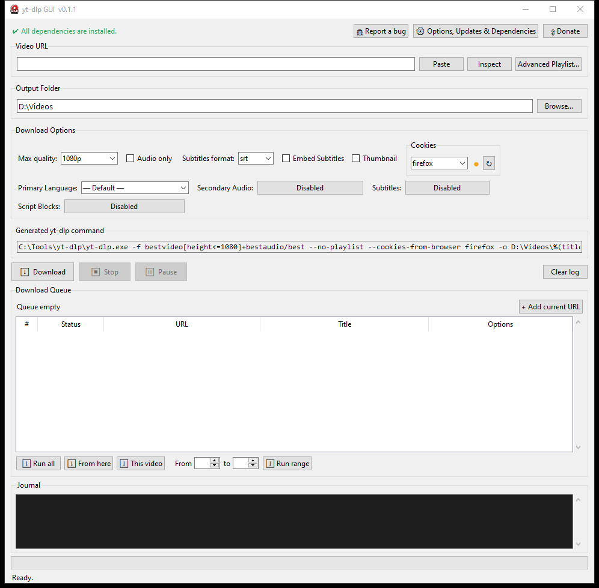
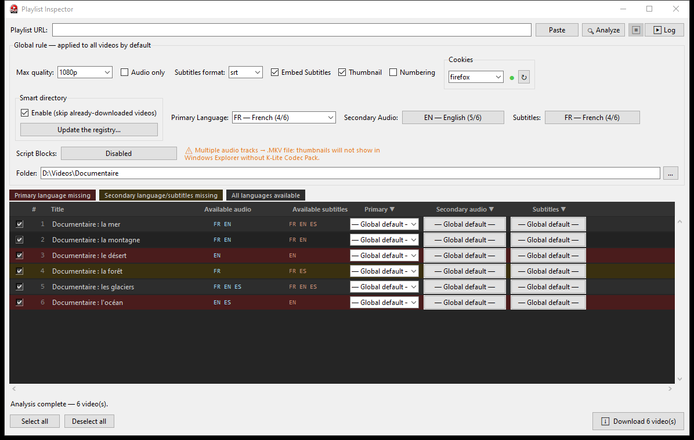
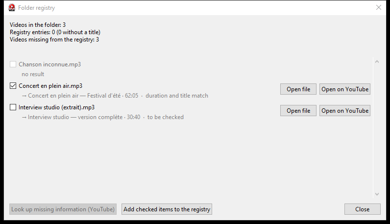

# yt-dlp GUI

[Français](../README.md) · [English](README.en.md) · [Español](README.es.md) · [Português](README.pt.md) · [Italiano](README.it.md) · [Polski](README.pl.md) · [Magyar](README.hu.md) · [Srpski](README.sr.md) · [Русский](README.ru.md) · [Tiếng Việt](README.vi.md) · [中文](README.zh.md) · [हिन्दी](README.hi.md) · [日本語](README.ja.md) · [한국어](README.ko.md) · [Filipino](README.fil.md)

[yt-dlp](https://github.com/yt-dlp/yt-dlp) のグラフィカルインターフェースです。誰でも使いやすく、その機能を最大限に活かせるように作られています。

> **開発中のプロジェクトです。** 一部の機能は変更されたり、未完成だったり、不具合を含んだりする場合があります。





## 機能

### 単体ダウンロードとキュー

- **オプション**：最高画質（4K まで）、音声のみ（MP3）、字幕（vtt、srt、ass 形式）、字幕とサムネイルの埋め込み、メインの音声言語、副音声トラック（マルチトラック MKV ファイル）、そして独自のブロックで拡張できる「スクリプトブロック」ライブラリ（後処理、エクスポート、ネットワーク、動作）。
- **複数の音声トラック**：MKV ファイルでは、各音声トラックに言語タグ（「jpn」「eng」など）が付き、プレーヤーの音声メニューに表示されます。
- **生成されたコマンド**：選択内容に対応する yt-dlp コマンドがリアルタイムで表示されます。
- **キュー**：現在の URL を追加し、キュー全体、特定の項目以降、1 本の動画、または範囲を実行できます。一時停止と再開、現在の項目のスキップ、途中ファイルの削除を伴う停止に対応。キューはセッション間で保持されます。
- **既存のファイル名**：保存先フォルダに同じ名前がある単体の動画には、何も上書きしないよう接尾辞（`_2`、`_3`…）が付きます。このダウンローダーで取得するプレイリストは番号が付け直されず、フォルダにすでにある動画はスキップされます（「has already been downloaded」）。

### プレイリストインスペクター

- プレイリストの**解析**：各動画が利用可能な音声トラックと字幕とともに一覧表示されます。非表示・非公開・削除済みの項目は、他の処理を妨げずに無視されます。
- **全体ルール**（画質、音声のみ、字幕の形式と埋め込み、サムネイル、番号付け、言語、スクリプトブロック、出力フォルダ）と、メイン言語・副音声トラック・字幕に対する**動画ごとの例外**。
- **色分け**：メイン言語がない場合は赤、副音声トラックまたは字幕がない場合はオレンジ。
- **選択項目のダウンロード**：ログ、一時停止、再開、スキップに対応。要求したトラックが存在しない場合はそれらを外して再試行し、その後、**結果の概要**で成功・調整・失敗を確認できます。

### スマートディレクトリと記録

- **スマートディレクトリ**：出力フォルダに保存された記録により、yt-dlp はダウンロード済みの動画をスキップします。`.yt-dlp-registre.json` ファイルには各動画の ID、URL、タイトル、長さ、ファイル名、日付が含まれ、yt-dlp が読む `.yt-dlp-archive.txt` はそこから生成されます。
- **遡っての確認**：選択した動画がすでにフォルダにあるのに記録にない場合、ウィンドウが（タイトルの比較により）記録してスキップすることを提案します。誤った一致はチェックを外せます。
- **記録を更新**：フォルダ内の動画、記録内の動画、不足している動画を数え、不足している情報を YouTube で検索します（タイトル、および ffprobe による長さ）。確認なしには何も記録されず、2 つのボタンでローカルファイルまたは見つかった YouTube リンクを開いて確認できます。



### ブラウザの Cookie

- yt-dlp がローカルで Cookie を読み取るブラウザ（Chrome、Firefox、Edge、Brave、Opera）を選択します。副音声トラックや一部の字幕に必要です。**Firefox を推奨します。**
- **私たちのテスト結果**（Windows 11、2026 年 10 月、各ブラウザで YouTube アカウントにログイン済み）：**Firefox** はブラウザが開いていても閉じていても動作します。**Opera** は**ブラウザを閉じているときだけ**動作します。起動中は Cookie データベースをロックし、yt-dlp に「Could not copy Chrome cookie database」と表示されます。**Chrome、Edge、Brave** は閉じていても失敗します。yt-dlp が常には読み取れない方式で Cookie を暗号化しているためです。これらの制限はブラウザと yt-dlp に由来し、このソフトウェアのものではなく、更新で変わる可能性があります。
- ブラウザが**終了時に Cookie を削除**する設定の場合（またはプライベートモードで閲覧している場合）、ディスク上に読み取れる Cookie は残りません。Chrome、Edge、Brave、Firefox のいずれでも yt-dlp は何も取得できません。Chrome、Edge、Brave ではこれが落とし穴になります。ブラウザを終了する必要があり、終了すると Cookie が消えるためです。この設定を無効にするか、youtube.com と google.com の Cookie を保持してください。
- **ランプ**で状態を表示：無効または失敗は赤、未テストまたは実行中はオレンジ、Cookie 読み込み済みは緑。↻ ボタンでテストを実行し、ツールチップが状態やエラーを説明します。

### セットアップアシスタント、依存関係、yt-dlp の更新

- **セットアップアシスタント**：初回起動時に、公式 GitHub リポジトリから yt-dlp と ffmpeg をダウンロードするよう提案します。SHA-256 チェックサムが検証され、管理者権限は不要です。
- **依存関係**：専用ウィンドウで ffmpeg、ffprobe、AtomicParsley、MKVToolNix、aria2、deno を確認し、Chocolatey でインストールできます。必須なのは ffmpeg と ffprobe だけです。deno は推奨（副音声トラック用）、AtomicParsley、MKVToolNix、aria2 は任意で、なくても動作します。
- **更新と診断**：yt-dlp を更新（`yt-dlp -U`）または実行ファイルを置き換え、バージョンを表示し、GUI が使うオプションを確認します。
- **ソフトウェアの更新**：1 日 1 回の確認（無効化可能）で、新しいバージョンを控えめなバナーでお知らせします。専用ウィンドウで新機能を確認でき、お使いのインストール形態（インストーラーまたはポータブル版）に合ったダウンロードを開きます。自動的にインストールされることはありません。オプションメニューのスイッチ（「起動時に更新を確認」）で自動確認の有効・無効を切り替えられ、「ソフトウェアの更新を確認…」でいつでも手動で確認できます。

### インターフェースと言語

- コントロールはウィンドウ幅に応じて折り返され、内容は縦にスクロールし、インスペクターの表は横にもスクロールします。
- **15 言語**に対応：フランス語、英語、スペイン語、ポルトガル語、イタリア語、ポーランド語、ハンガリー語、セルビア語、ロシア語、ベトナム語、中国語、ヒンディー語、日本語、韓国語、フィリピン語。言語の変更は再起動後に反映され、すぐに再起動することもできます。

### 不具合を報告

- 「不具合を報告」ボタンは技術レポートを作成します：ソフトウェア、Python、Windows、yt-dlp のバージョン、問題のない設定、ログの最後の数行。フォルダ、ユーザー名、メールアドレスは伏せ字になります。GitHub でレポートを送信するには、無料の GitHub アカウントが必要です。
- 自動送信は一切されません：レポートを確認・編集してから、入力済みの GitHub イシューページを開きます（またはレポートをコピーします）。

## インストール

- **インストーラー（推奨）**：[リリースページ](https://github.com/harlockSuites/YT-dlp-GUI/releases)から `yt-dlp-gui-setup-X.Y.Z.exe` をダウンロードして実行します。Windows 10 または 11（64 ビット）に対応し、管理者権限は不要です。Python も必要ありません。
- **ポータブル版**：`yt-dlp-gui-portable-X.Y.Z.zip` をダウンロードし、好きな場所に展開して `yt-dlp-gui.exe` を実行します。設定はそのフォルダ内に保存されます。
- **ソースから**：下の「必要条件」と「クイックスタート」を参照してください。
- **アンインストール**：Windows の設定 › アプリ › インストールされているアプリ › yt-dlp GUI、またはスタートメニューの「アンインストール」ショートカット。ソフトウェアは自身のデータ（設定、キュー、ダウンロードした yt-dlp と ffmpeg）も削除するか尋ねます。動画は決して削除されません。インストールは Windows アカウントごとのため、インストールしたアカウントの一覧にのみ表示されます。ポータブル版はフォルダーを削除するだけです。Chocolatey で別途インストールしたツール（ffmpeg、Deno など）は削除されません。
- **ウイルス対策の検査結果（VirusTotal）**：バージョン 0.1.7 は 2026 年 10 月 21 日に検査されました。[インストーラー](https://www.virustotal.com/gui/file/7177f2dc75c3b5309b2d6b96a2104d578dbaf67a0c8ed28af286aa37159df91c)は 69 エンジン中 4 つ（Arctic Wolf、Microsoft、SecureAge、Skyhigh）が汎用のヒューリスティック検出として検出しています。[ポータブル版のランチャー](https://www.virustotal.com/gui/file/6889bde864b341a948dc23c01e29eba3c63315145705eb0d5bb24a4964b0735a)は 70 中 5 つ（Arctic Wolf、CrowdStrike Falcon、Microsoft、SecureAge、Zillya）、[ポータブル版の ZIP アーカイブ](https://www.virustotal.com/gui/file/7fd0a4bb101ca4b4c513ff42e0782cc2371304c643bf03cb3ccd8e9abdb43706)は 66 中 1 つ（Zillya、アーカイブ自体に対する検出）が検出しています。圧縮された未署名のプログラムによる誤検出の可能性が高いです。この結果はこのバージョンのみに該当します。不安な場合は SHA-256 を確認してください。
- **Code signing policy**：今後のバージョンのデジタル署名を準備中です（SignPath Foundation への申請）。[コード署名ポリシー](https://github.com/harlockSuites/YT-dlp-GUI/blob/main/docs/CODE_SIGNING_POLICY.md)に手順を記載しています。0.1.4 までのバージョンは署名されていません。
- **Windows SmartScreen の警告**：インストーラーにはデジタル署名がないため、Windows に「Windows によって PC が保護されました」と表示されることがあります。「詳細情報」をクリックし、「実行」を選んでください。ファイルの真正性を確認するには、各リリースと一緒に公開されている `SHA256SUMS.txt` の SHA-256 値と比較します：

```powershell
Get-FileHash .\yt-dlp-gui-setup-X.Y.Z.exe -Algorithm SHA256
```

## Windows とブラウザーの警告

このソフトは無料で、個人が公開しており、ファイルは**まだ電子署名されていません**。ほとんど誰もダウンロードしていない新しいファイルには「評判」がないため、ブラウザーや Windows は**安全なソフトでも**警告を表示します。警告があっても危険とは限らず、警告がなくても安全とは限りません。ご自身で確認する方法は次のとおりです。

- **ブラウザー**（Firefox、Chrome、Edge、Brave）：ダウンロードが「あまりダウンロードされていない」または「ウイルスやマルウェアを含む」と表示されることがあります。これはファイルの評判の自動チェックです。まず下のチェックサムを確認し、一致すれば、ダウンロードを許可または保持する選択肢を選べます。
- **Windows SmartScreen**：「Windows によって PC が保護されました」→ チェックサムを確認した**後で**「詳細情報」、続いて「実行」をクリックします。
- **Microsoft Defender（Windows セキュリティ）**：ファイルが隔離または削除され、「Trojan:Win32/Wacatac.C!ml」と表示されることがあります。末尾の `!ml` は機械学習による自動検出を意味し、新しく署名のないファイルでよく見られます。これらの検出は誤検出として Microsoft に報告済みです。SHA-256 を確認した後（下記）、ファイルを復元できます：Windows セキュリティ › ウイルスと脅威の防止 › 保護の履歴 › 項目を開く › アクション › 「デバイスで許可」（または「復元」）。Windows の保護を無効にしたり、このファイルだけより広い除外を追加したりしないでください。
- **ウイルス対策**：一部のエンジンが汎用の検出を表示します（上のウイルス対策の検査結果を参照）。ご自身のファイルの検査結果を見るには、その SHA-256 を [VirusTotal](https://www.virustotal.com/) の検索欄に貼り付けてください。ファイルがすでに知られていれば、アップロードせずにレポートが表示されます。
- **ダウンロードの確認**：同じリリースのページから `SHA256SUMS.txt` もダウンロードし、ファイルのあるフォルダーで PowerShell を開いて下のコマンドを実行します。各ファイルを公開された値と比較し、`OK` または `DIFFERENT` を表示します。`DIFFERENT` のファイルは実行しないでください。

```powershell
Get-Content .\SHA256SUMS.txt | ForEach-Object { $h, $n = $_ -split '\s+\*?', 2; if ((Get-FileHash $n -Algorithm SHA256).Hash -eq $h.ToUpper()) { "$n : OK" } else { "$n : DIFFERENT" } }
```

- この確認は、ファイルが GitHub で公開されたものと**同一**であることを示しますが、それだけで無害であることの証明にはなりません。ソースコードとファイルの自動ビルド（[GitHub Actions](https://github.com/harlockSuites/YT-dlp-GUI/actions)）は公開されており、電子署名は準備中です（「Code signing policy」を参照）。

## 必要条件

- Windows
- Tkinter を含む [Python 3](https://www.python.org/)（標準インストールに含まれます）
- `yt-dlp.exe`、できれば [ffmpeg](https://ffmpeg.org/) も：セットアップアシスタントが初回起動時にダウンロードします

## クイックスタート

1. このリポジトリをダウンロードまたはクローンし、そのフォルダに移動します。
2. `yt-dlp-gui.bat`（または `pythonw yt-dlp-gui.pyw`）を実行します。
3. 初回起動時は、アシスタントに yt-dlp と ffmpeg をインストールさせます。アシスタントはオプションメニューからいつでも開けます。
4. URL を貼り付け、オプションを選び、ダウンロードするか、キューに追加するか、プレイリスト用にインスペクターを開きます。

## プライバシーと責任ある利用

- このソフトウェアは作者にデータを送信せず、テレメトリも含みません。ネットワーク接続は yt-dlp（動画サイト）、セットアップアシスタント（GitHub）、記録ツール（YouTube 検索）を通じて行われます。更新の自動確認も起動時に GitHub に接続します（1 日 1 回まで）。「起動時に更新を確認」から無効にできます。
- Cookie はお使いのコンピューターに残ります。yt-dlp が選択したブラウザからローカルで読み取ります。
- 著作権、各サイトの利用規約、お住まいの国の法律を守って本ツールを使用し、ダウンロードする権利のあるものだけをダウンロードしてください。

## 開発

テスト（翻訳、記録、コマンド構築、インターフェース、セットアップアシスタント、ドキュメント）は次のコマンドで実行します：

```bash
python -X utf8 -m unittest discover -s tests -t .
```

プッシュのたびに GitHub 上でも自動的に実行されます。バージョン番号は `yt-dlp-gui.pyw` の `__version__` で定義され、[CHANGELOG.md](../CHANGELOG.md) の見出しと一致している必要があります。インターフェースの翻訳ファイルは `lang/` に、このドキュメントの翻訳は `docs/` にあります。ネイティブスピーカーによる校閲を歓迎します。

## プロジェクトを支援する

この GUI は、これまでも、今も、これからも無料で、誰にでも開かれています。このツールが特に役立った場合は、[Ko-fi](https://ko-fi.com/harlocksuites) でプロジェクトを支援していただけます。

## 謝辞

[yt-dlp](https://github.com/yt-dlp/yt-dlp) を定期的に更新しているコミュニティに感謝します。それなしには、これらすべては実現しませんでした。

## ライセンス

コードは [MIT](../LICENSE) ライセンスで公開されています。アイコン、ロゴ、「Harlock S.」バナー（`yt-dlp-gui.ico` ファイルと `assets/` フォルダ）は、作者の依頼で AI が生成したオリジナルの作品です。これらはプロジェクトのビジュアルアイデンティティであり、MIT ライセンスの対象外です。他のプロジェクトでの再利用や、混同を招く使い方はご遠慮ください。
